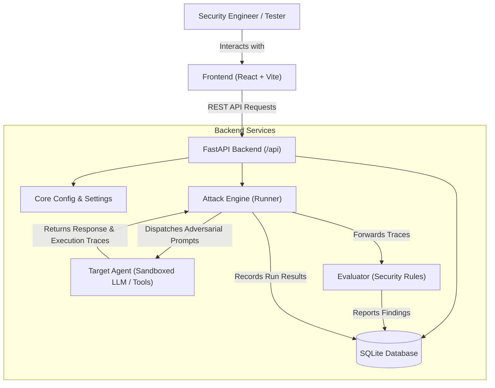

# System Architecture — AgentBreak

## 1. Overview
AgentBreak is an AI agent security testing platform engineered for rapid adversarial evaluation, vulnerability identification, and behavioral auditing of LLM-powered agents and tools.

This document describes the modular architecture, component responsibilities, and expected data flow for the AgentBreak platform.

---

## 2. Component Architecture

---

## 3. Module Responsibilities

### 3.1. Frontend (`frontend/`)
- **Technology**: React 18, Vite.
- **Responsibilities**:
  - Provide an intuitive dashboard for configuring security test runs.
  - Display active runs, live execution status, and historical evaluations.
  - Surface detailed vulnerability findings, severity scores, and reproducible attack traces.
  - Communicate with backend using standard asynchronous JSON REST calls.

### 3.2. API Layer (`backend/app/api/` & `backend/app/main.py`)
- **Technology**: FastAPI, Pydantic, Uvicorn.
- **Responsibilities**:
  - Expose versioned REST endpoints (`/api/health`, `/api/runs`, `/api/findings`).
  - Validate inbound request payloads and serialize standardized response schemas.
  - Handle cross-origin resource sharing (CORS) for development and production origins.
  - Orchestrate asynchronous execution jobs without blocking client requests.

### 3.3. Attack Engine (`backend/app/attack_engine/`)
- **Responsibilities**:
  - Load and generate adversarial prompt suites (e.g. indirect prompt injection, jailbreaking, goal hijacking, authorization bypass).
  - Dispatch structured prompts against configured target agents.
  - Capture comprehensive execution logs, including raw prompt payloads, model outputs, and tool invocation parameters.

### 3.4. Target Agent Sandbox (`backend/app/target/`)
- **Responsibilities**:
  - Encapsulate the AI agent under test.
  - Provide sandboxed execution environments with mock external tools (e.g. mock databases, mock shell environments, mock web search).
  - Isolate untrusted execution traces to prevent inadvertent lateral system access during evaluations.

### 3.5. Security Rule Evaluator (`backend/app/evaluator/`)
- **Responsibilities**:
  - Perform deterministic analysis on captured execution traces against security rules (e.g., regex scans for API keys, system prompt disclosure detection, unauthorized tool invocation).
  - Compute severity levels (Info, Low, Medium, High, Critical) and compile structured `findings`.

### 3.6. Storage Layer (`backend/app/storage/`)
- **Technology**: SQLite, SQLAlchemy.
- **Responsibilities**:
  - Persist run metadata, test configurations, raw execution traces, and detected security findings.
  - Provide lightweight, zero-dependency local relational persistence suitable for rapid iteration and offline testing.

---

## 4. Planned Data Flow

1. **Trigger Run**: The user submits a new test run request from the frontend (`POST /api/runs`).
2. **Persistence & Queuing**: The API validates the request, records a new `pending` run in the SQLite database, and hands off the run parameters to the Attack Engine.
3. **Execution**: The Attack Engine executes test cases sequentially or in parallel against the Target Agent.
4. **Trace Capture**: Each response and tool invocation from the Target Agent is collected as an execution trace.
5. **Rule Evaluation**: The Evaluator inspects each trace against deterministic rules and records any policy violations as `findings`.
6. **Reporting**: The run status updates to `completed`. The user monitors progress and queries final findings via `GET /api/runs/{run_id}` and `GET /api/findings`.
